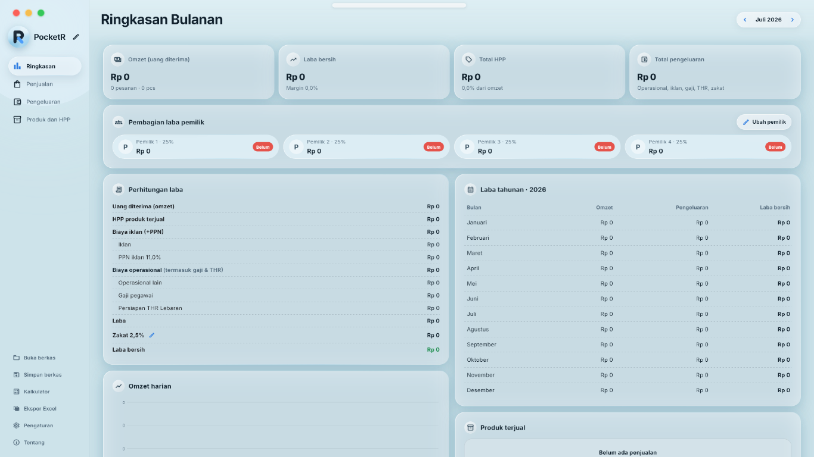
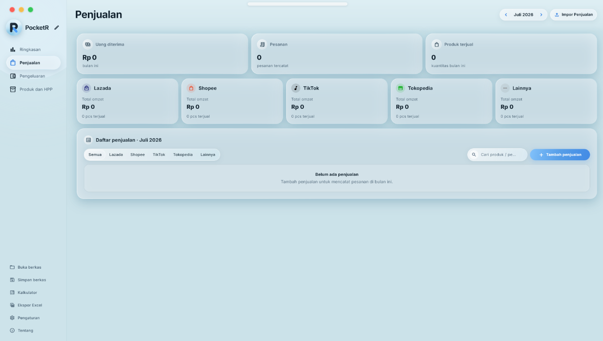
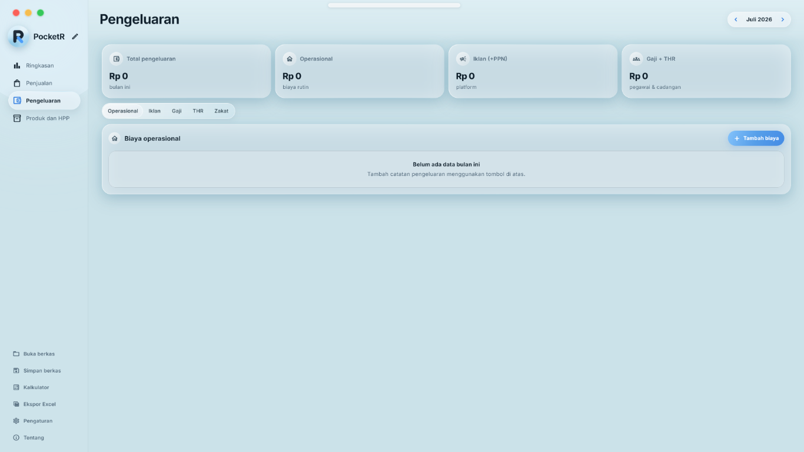
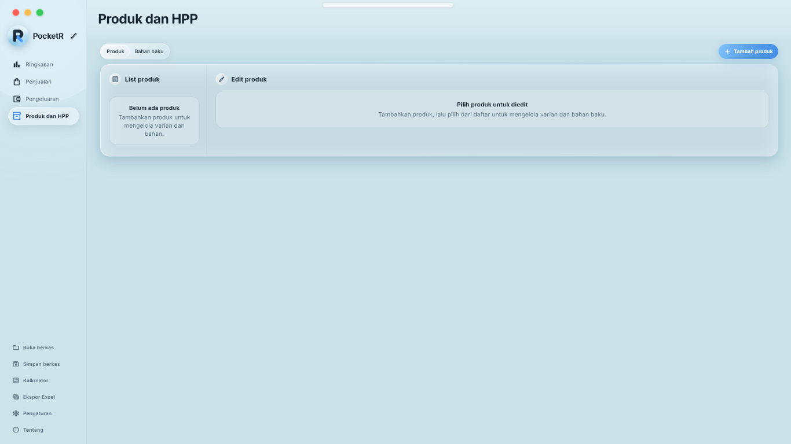
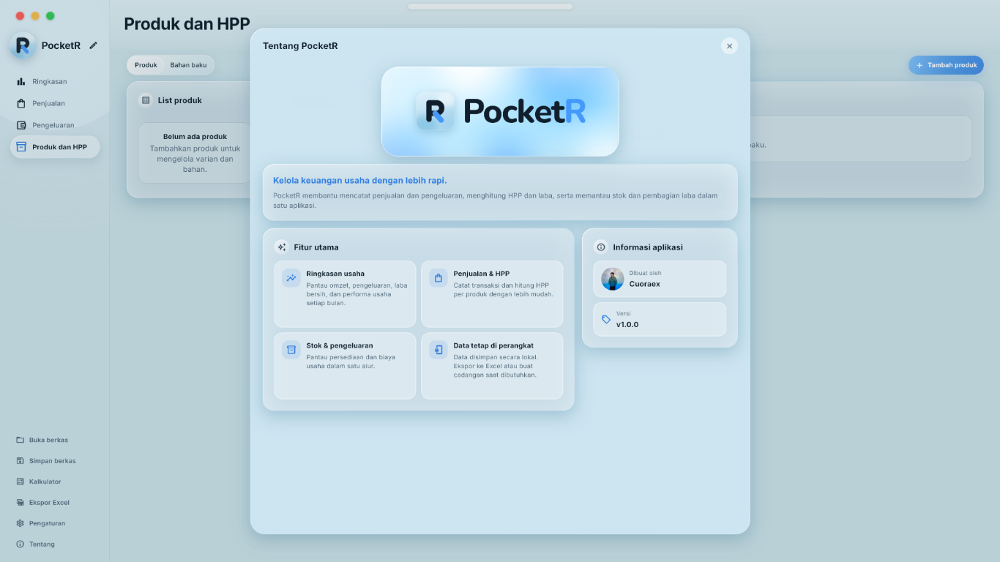

# PocketR

PocketR adalah aplikasi pencatatan keuangan usaha berbasis Flutter. Aplikasi
membantu mengelola penjualan, biaya, produk, HPP, stok, dan pembagian laba
dalam satu tempat. Data disimpan secara lokal di perangkat.

## Fitur

### Keuangan usaha

- Ringkasan bulanan dan tahunan, omzet harian, target omzet, laba, dan performa
  marketplace.
- Pencatatan penjualan berdasarkan tanggal, marketplace, produk, varian,
  kuantitas, nomor pesanan, uang diterima, dan HPP.
- Pencatatan biaya operasional, iklan, gaji, THR, dan zakat.
- Penghitungan PPN iklan, laba bersih, zakat mal, serta pembagian dan status
  pembayaran bagian pemilik.

### Produk, HPP, dan stok

- Kelola produk, foto, warna, ukuran, varian lain, serta rincian bahan baku dan
  ongkos.
- Impor rincian HPP dari template Excel. HPP yang diimpor disimpan untuk produk
  terkait tanpa mengubah katalog bahan baku bersama.
- Impor template HPP dan penjualan manual menerima rumus aritmetika pada kolom
  angka: `+`, `-`, `*`, `/`, `^`, `%`, tanda kurung, dan referensi sel pada
  lembar yang sama. Fungsi Excel seperti `SUM` dan `ROUND` belum didukung.
- Catat stok awal dan perubahan stok, atur batas peringatan, serta kurangi stok
  berdasarkan penjualan.

### Impor dan ekspor

- Impor penjualan manual dari template Excel (`.xlsx`), termasuk kolom
  marketplace. Pilihan marketplace yang dikenali: Shopee, Tokopedia, Lazada,
  TikTok, dan Lainnya.
- Impor pesanan Shopee dari file rincian pesanan selesai dan laporan saldo.
  Impor langsung dari file marketplace lain belum tersedia karena format
  ekspornya berbeda.
- Impor data HPP dan unduh template HPP.
- Ekspor data ke Excel (`.xlsx`) berdasarkan bulan yang dipilih, mencakup
  ringkasan, penjualan, pengeluaran, serta produk dan HPP. Data penjualan dan
  pengeluaran menyertakan marketplace terkait.

## Detail layar

- **Ringkasan** — menampilkan performa bulan terpilih, omzet dan laba, grafik
  omzet harian, penjualan per marketplace, produk terjual, target omzet, serta
  pembagian laba pemilik. Tersedia juga ringkasan tahunan.
- **Penjualan** — menampilkan transaksi beserta tanggal, platform, pesanan,
  produk dan varian, kuantitas, uang diterima, dan HPP. Penjualan dapat dicari
  dan difilter, serta diimpor dari template manual atau file Shopee.
- **Pengeluaran** — mengelompokkan biaya operasional, iklan, gaji, THR, dan
  zakat. Rincian iklan dapat mencatat platform, produk terkait, dan PPN.
- **Produk dan HPP** — menampilkan katalog produk, varian, bahan baku, ongkos,
  perhitungan HPP, dan informasi stok.
- **Pengaturan** — mengatur bahasa dan auto-save lokal, membuat atau memulihkan
  backup lengkap termasuk foto, atau mengatur ulang data.
- **Tentang** — merangkum fitur aplikasi, menampilkan versi, serta menyediakan
  tautan profil sosial dan repositori GitHub untuk melihat pembaruan.

## Screenshot

Screenshot berikut menunjukkan tampilan desktop dengan data contoh kosong.
Versi pada screenshot halaman Tentang dapat berbeda dari versi aplikasi saat ini.

### Ringkasan

### Penjualan

### Pengeluaran

### Produk dan HPP

### Tentang

## Backup dan pemulihan

- Data utama tersimpan otomatis di perangkat.
- **Backup Settings** di Pengaturan membuat backup lengkap yang mencakup data,
  foto profil dan produk, serta berkas impor yang tersimpan di arsip aplikasi.
- Backup reguler dan auto-save lokal memakai file `.pcktr`; file auto-save
  bernama `pocketr-autosave.pcktr` dan ditimpa pada setiap interval yang dipilih.
  Auto-save tidak menyertakan foto.
- Tombol **Restore Settings** di Pengaturan atau menu **Buka Berkas** dapat
  digunakan untuk memulihkan backup dari file `.pcktr` atau `.json`.
- Backup JSON dari aplikasi PocketR juga dapat dipulihkan melalui alur
  tersebut.

## Bahasa dan aplikasi

Antarmuka tersedia dalam Bahasa Indonesia dan English. Pengaturan bahasa
disimpan di perangkat. Pada halaman **Tentang**, tautan sosial Cuoraex dan
repositori GitHub tersedia; **Check for update** membuka repositori untuk
melihat informasi versi terbaru.

## Tautan

- GitHub: <https://github.com/cuoraex/pocketr>
- Profil Cuoraex: <https://github.com/cuoraex>
- Donasi via Tako: <https://tako.id/Cuoraex>
